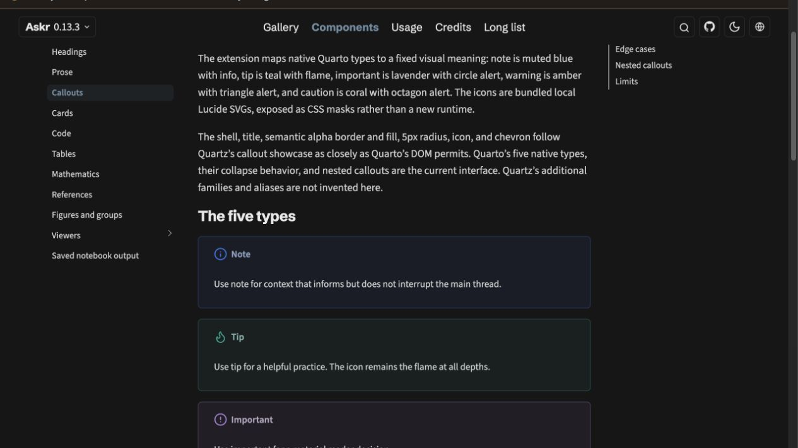

# Askr

Make dense scientific documentation easier to read while preserving Quarto's
native authoring and site behavior.

**Live demos:** [English gallery](https://arfiligol.github.io/askr/) ·
[繁體中文圖集](https://arfiligol.github.io/askr/zh-TW/)

[](https://arfiligol.github.io/askr/components/callouts.html)

*Open the screenshot's [live Callouts demo](https://arfiligol.github.io/askr/components/callouts.html).*

## Why Askr

- Keep reading and navigation coherent across light and dark themes.
- Make code, equations, and wide scientific tables easier to follow.
- Inspect static images and interactive charts in context, then return to the article.
- Author native Quarto pages, install Askr as a Quarto extension, and explore
  the English or Traditional Chinese demo.

Quarto remains responsible for authoring, rendering, site navigation, search,
the table of contents, and native document behavior. Askr is an installable
HTML format that styles those pages and adds documented scientific reading
components.

## Quick start

Askr `v0.13.3` supports stable Quarto `>=1.9.38 <1.11`; the gallery and CI
baseline is Quarto `1.10.18`.

Install the current stable release:

```bash
quarto add arfiligol/askr@v0.13.3 --no-prompt
```

Create `_quarto.yml`:

```yaml
project:
  type: website

website:
  title: "Lab notes"

format:
  askr-html:
    toc: true
    code-copy: true
    respect-user-color-scheme: true
    smooth-scroll: false # avoids the Zenscroll conflict in RequireJS setups
```

Add an `index.qmd` page:

```markdown
---
title: "Coupled-mode analysis"
---

Summarize the model, then guide readers through its assumptions and results.
```

Preview the site from the project folder:

```bash
quarto preview .
```

## Find a component

| If you need… | Start here |
| --- | --- |
| A consistent article layout, headings, callouts, or cards | [Components guide](https://arfiligol.github.io/askr/components.html) · [Callouts](https://arfiligol.github.io/askr/components/callouts.html) · [Cards](https://arfiligol.github.io/askr/components/cards.html) |
| Readable code, tables, equations, or references | [Code](https://arfiligol.github.io/askr/components/code.html) · [Tables](https://arfiligol.github.io/askr/components/tables.html) · [Mathematics](https://arfiligol.github.io/askr/components/mathematics.html) · [References](https://arfiligol.github.io/askr/components/references.html) |
| Static figures or interactive charts | [Figures](https://arfiligol.github.io/askr/components/figures.html) · [Image viewer](https://arfiligol.github.io/askr/components/image-viewer.html) · [Chart viewer](https://arfiligol.github.io/askr/components/chart-viewer.html) |
| Organize Areas, pages, and section links | [Navigation](https://arfiligol.github.io/askr/usage/navigation.html) · [Layout gallery](https://arfiligol.github.io/askr/gallery/layout.html) |
| Set a reading width, language menu, or site announcement | [Add Askr](https://arfiligol.github.io/askr/usage/add-askr.html) · [Language selector](https://arfiligol.github.io/askr/usage/languages.html) · [Announcements](https://arfiligol.github.io/askr/usage/announcements.html) |
| Change theme tokens and local styles | [Token customization](https://arfiligol.github.io/askr/usage/tokens.html) |

## Customize

Set site options in `_quarto.yml` and keep consumer Sass or CSS in your own
project. For example, `askr.reading-width: wide` widens the article measure;
`askr.page-facts` can add a short role or reader-task line below a page's
description. The [Add Askr guide](https://arfiligol.github.io/askr/usage/add-askr.html)
explains supported options, and [Tokens](https://arfiligol.github.io/askr/usage/tokens.html)
shows how to extend the theme without editing the installed extension.

To update a consumer, install a reviewed release tag again, render the site,
and commit the updated `_extensions` copy. Keep consumer-specific styles in
your project.

## License and credits

Askr's source is MIT licensed. The theme adapts selected visual ideas from
Quartz; fonts and icons keep their own licenses. See the [MIT license](LICENSE),
[credits](credits.qmd), [third-party notices](THIRD_PARTY.md), and
[bundled asset manifest](ASSET_MANIFEST.md).

## Maintenance

Render and preview the bilingual gallery from the repository root:

```bash
quarto render .
quarto preview .
```

The root Quarto project builds English and runs the Traditional Chinese
post-render step. Historical source snapshots live under `archives/v*/`; the
published site continues to serve their pages at `/v*/`.
