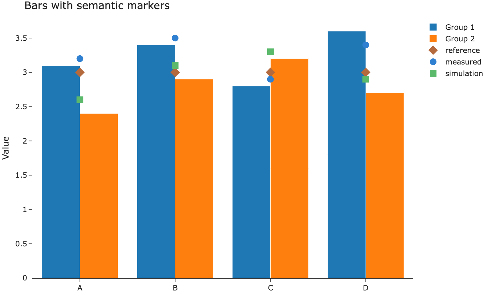
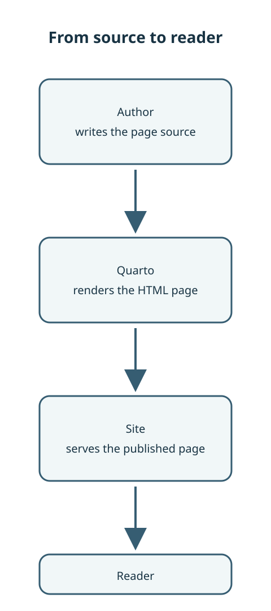

Quarto keeps its native columns, figures and captions. The optional
`.askr-grid` and `.askr-figure-fit` wrappers address specific layout needs
while leaving content in the article.

## Columns

::: {.columns}
::: {.column width="50%"}
The left column is half of the content measure.
:::

::: {.column width="50%"}
The right column is the other half. Standard Quarto columns retain Quarto's
responsive behavior; use `.askr-grid` for a pair that stays two columns from
768px and stacks below that width.
:::
:::

## Responsive groups {#responsive-groups}

Use `.askr-grid` around two callouts or cards to create equal columns at
viewport widths of at least 768px and one column below that. Source order is
also reading order.

::: {.askr-grid}
::: {.callout-note title="Prepare the source"}
Keep the first item concise and useful on its own.
:::

::: {.callout-tip title="Check the result"}
The second item follows the first in both layout and reading order.
:::
:::

::: {.askr-grid}
:::: {.askr-card}
::: {.askr-card-body}
### [Read about cards](cards.qmd) {.askr-card-title .unlisted}

Cards keep their ordinary heading links.
:::
::::

:::: {.askr-card}
::: {.askr-card-body}
### [Read about callouts](callouts.qmd) {.askr-card-title .unlisted}

Callouts keep their native Quarto semantics.
:::
::::
:::

## Tabset

These two groups stay in step. Choosing Palace or AEDT in one group selects it in the other. The article underneath does not sit in a second card.

::: {.panel-tabset group="backend"}
## Palace

Palace uses the shared layout and its own electrostatic input.

## AEDT

AEDT Q3D uses the same layout and its own input binding.
:::

::: {.panel-tabset group="backend"}
## Palace

The eigenmode result is read from the Palace run.

## AEDT

The eigenmode result is read from the HFSS run.
:::

## Image

Images in this document come from Embla. The chart below is
its bars-and-markers figure, saved here as a static image. Quarto's folded
cell keeps the embed source behind Source and shows the image underneath.



A page that only needs the picture, without a source disclosure, embeds it
directly:

```markdown

```

## Fit a tall figure to the viewport {#figure-fit}

Opt in with `.askr-figure-fit` when a tall image should fit within 70svh
(70vh fallback) while keeping its aspect ratio. Ordinary figure behavior is
unchanged. The native caption remains below the image, and the existing Askr
Image Viewer continues to handle image inspection.

::: {.askr-figure-fit}
{#fig-viewport-fit fig-alt="Tall flow diagram showing source, rendering and reading"}
:::

## Image viewer {#image-viewer}

<span id="inline-interaction"></span>
<span id="svg-interaction"></span>
<span id="gallery"></span>
<span id="excluded-image"></span>
<span id="image-with-a-link"></span>

The [dedicated Image viewer page](image-viewer.qmd) demonstrates static images,
inline inspection, floating views and galleries. For a chart with its own
interactive controls, see [Chart viewer](chart-viewer.qmd).

## Theme toggle

Quarto keeps two outputs from one cell and shows one of them. `body.quarto-dark` hides `.light-content`; `body.quarto-light` hides `.dark-content`. Askr's dark stylesheet is marked `data-mode="dark"`, so the header toggle adds and removes `quarto-dark` with the stylesheet.

Emit the light output first, then the dark output:



The same order works for a Plotly figure: draw the light figure, then the dark figure, under `#| renderings: [light, dark]`. The figure colors are baked into each output. The toggle does not recolor a single picture.

## Diagram

This simple, unwrapped Mermaid block stays native in the article and does not
add viewer controls:

```{mermaid}
flowchart LR
  Areas[Areas] --> Pages[Page List]
  Pages --> Article[Article]
  Article --> Sections[Section List]
```

Mermaid also supports a conditional edge label on a branch. This example uses
the existing diagram viewer wrapper:

::: {.askr-mermaid-view view-label="View diagram"}
```{mermaid}
flowchart TD
  Start[Start] --> Check{Ready?}
  Check -->|Yes| Done[Continue]
  Check -->|No| Wait[Prepare inputs]
```
:::

This gallery does not ship a photograph.

## Mermaid viewer {#mermaid-viewer}

Wrap exactly one native Mermaid block in `.askr-mermaid-view` to add a
`View diagram` button below the rendered graph. The graph remains in the
article; the button opens its floating viewer. The wide flow below keeps its
natural width in a keyboard-focusable horizontal scroll region.

::: {.askr-wide-figure aria-label="Public documentation flow"}
::: {.askr-mermaid-view view-label="View diagram"}
```{mermaid}
flowchart LR
  subgraph author["Authoring"]
    direction TB
    source["Write one native<br/>Mermaid block"] --> wrapper["Add the optional<br/>viewer wrapper"]
  end
  subgraph build["Build and publish"]
    direction TB
    render["Quarto renders<br/>the HTML page"] --> publish["Publish the<br/>documentation"]
  end
  subgraph reader["Reading"]
    direction TB
    article["Diagram appears<br/>in the article"] --> open["Choose View diagram"] --> inspect["Zoom, pan or Fit<br/>in the floating viewer"] --> close["Close and return<br/>to the article"]
  end
  wrapper --> render
  publish --> article
```
:::
:::

Use `View diagram` to open the rendered graph in the floating viewer. The
adjacent `Mermaid source` disclosure below the graph expands the authored block
on demand; its `Copy` button copies the source. See the
[Mermaid viewer guide](../usage/image-viewer.qmd#mermaid-viewer) for controls
and limits.

## Limits

Standard columns, the opt-in `.askr-grid`, tabset and simple diagram fit the article width. The wider flow
uses `.askr-wide-figure` to keep its natural size and scroll horizontally. A
floating viewer can zoom, but does not replace readable labels or logical
grouping. Redraw a diagram if its labels or relationships remain hard to
follow; do not shrink its text to force a poster into a column.
