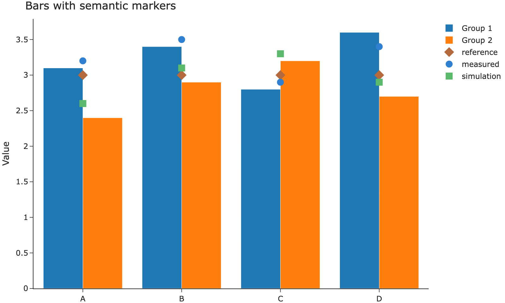

Inspect static SVG, PNG and JPEG images inline or in a floating window. Askr supplies zoom, pan and Fit controls for the image.

Click an independent figure or its button to open Askr's floating viewer.
Use + / −, Fit, drag to pan or pinch to zoom. Escape returns to the article.

{#fig-viewer}



This button opens the same image and caption as the figure above. A button-only
entry registers its own hidden image source:



## Inline interaction

This PNG can be inspected directly in the article. Expand it after zooming:
the same camera state follows you into the floating viewer and back.

{#fig-inline}



## SVG interaction

This existing Askr icon is vector artwork, not a scientific layout. Its
geometry remains sharp when enlarged. Its camera is independent of the PNG.



## Gallery

{group="viewer-formats"}

{group="viewer-formats"}

## Excluded image

This image deliberately has no floating viewer:

{.nolightbox width=45%}

## Image with a link

The image below remains a normal navigation link to the figure Usage page.

[{fig-alt="Figure Usage" width=45%}](../usage/figures.qmd)

See [Image viewer](../usage/image-viewer.qmd) for opt-outs, button syntax, and
grouped galleries.

## Choose the viewer

Use this viewer when the delivered asset is a static image. A chart exported
as HTML keeps its own hover, zoom and pan controls in the
[Chart viewer](chart-viewer.qmd). See the [Image viewer guide](../usage/image-viewer.qmd)
for authoring options.
