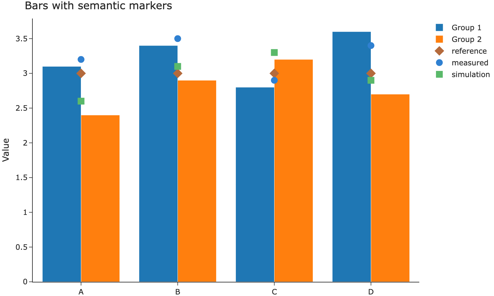
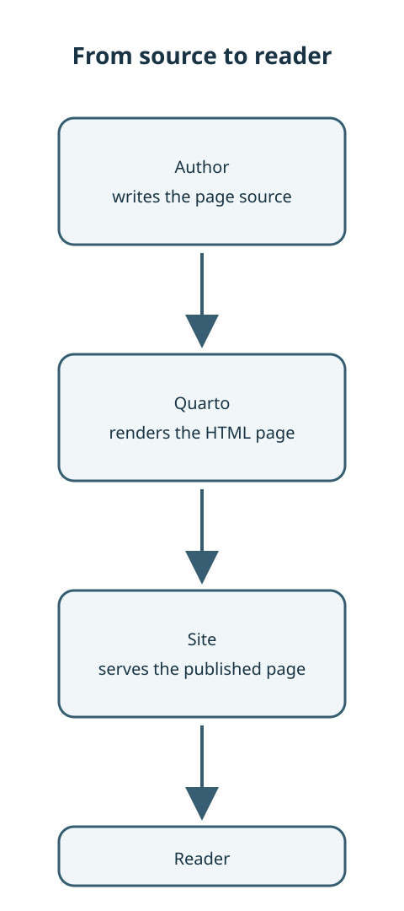

Quarto 仍負責原生欄位、圖形與標題。選用的 `.askr-grid` 與
`.askr-figure-fit` 包裝則用於特定版面需求，內容仍留在文章中。

## 欄

::: {.columns}
::: {.column width="50%"}
左欄占閱讀欄的一半。
:::

::: {.column width="50%"}
右欄占另一半。一般 Quarto 欄位仍依 Quarto 的方式調整；若要讓一組內容在
768px 以上維持兩欄、以下改為單欄，請使用 `.askr-grid`。
:::
:::

## 響應式群組 {#responsive-groups}

將兩個提示框或卡片包在 `.askr-grid` 中，可在視窗寬度至少 768px 時呈現等寬雙欄，
低於該寬度時改為單欄。原始碼順序也就是閱讀順序。

::: {.askr-grid}
::: {.callout-note title="準備來源"}
第一個項目應簡潔，且單獨閱讀時仍有完整用途。
:::

::: {.callout-tip title="檢查結果"}
第二個項目在版面與閱讀順序中都接在第一個項目之後。
:::
:::

::: {.askr-grid}
:::: {.askr-card}
::: {.askr-card-body}
### [卡片說明](cards.qmd) {.askr-card-title .unlisted}

卡片仍使用一般標題連結。
:::
::::

:::: {.askr-card}
::: {.askr-card-body}
### [提示框說明](callouts.qmd) {.askr-card-title .unlisted}

提示框仍保有 Quarto 原生語意。
:::
::::
:::

## 分頁組

這兩組分頁會同步切換。在其中一組選擇 Palace 或 AEDT，另一組也會選取相同項目。下方文章不會被包在第二張卡片中。

::: {.panel-tabset group="backend"}
## Palace

Palace 使用共用版圖與自己的靜電輸入資料。

## AEDT

AEDT Q3D 使用相同版圖與自己的輸入綁定。
:::

::: {.panel-tabset group="backend"}
## Palace

特徵模態結果取自 Palace 執行結果。

## AEDT

特徵模態結果取自 HFSS 執行結果。
:::

## 圖片

本文件中的圖片來自 Embla。下方圖表是該專案的長條與標記圖，並以靜態圖片儲存於此。Quarto 折疊儲存格中的來源會收在 Source 後方，圖片則顯示於下方。



若頁面只需顯示圖片、不需公開來源，可直接嵌入：

```markdown

```

## 讓高圖形符合視窗高度 {#figure-fit}

當高圖形需要在保留長寬比的同時符合 70svh（並以 70vh 作為後備）時，可選用
`.askr-figure-fit`。一般圖形行為不會改變。原生圖說仍顯示在圖片下方，
並由既有的 Askr 圖片檢視器提供圖片檢視功能。

::: {.askr-figure-fit}
{#fig-viewport-fit fig-alt="顯示來源、產生與閱讀流程的高圖"}
:::

## 圖片檢視器 {#image-viewer}

<span id="行內互動"></span>
<span id="svg-互動"></span>
<span id="圖集"></span>
<span id="排除的圖片"></span>
<span id="帶連結的圖片"></span>

[獨立的圖片檢視器頁](image-viewer.qmd)展示靜態圖片、正文操作、浮動檢視與圖集。若圖表本身有互動控制項，請見[圖表檢視器](chart-viewer.qmd)。

## 主題切換

Quarto 會從同一個儲存格產生兩份輸出，並顯示其中一份。`body.quarto-dark` 會隱藏 `.light-content`；`body.quarto-light` 會隱藏 `.dark-content`。Askr 的深色樣式表以 `data-mode="dark"` 標示，因此標題列的切換按鈕會隨樣式表加入或移除 `quarto-dark`。

先輸出淺色內容，再輸出深色內容：



Plotly 圖形也適用相同順序：在 `#| renderings: [light, dark]` 下，先繪製淺色圖，再繪製深色圖。每份輸出的圖形顏色會固定下來；切換按鈕不會重新替單張圖片著色。

## 圖表

下方未加包裝的簡單 Mermaid 區塊會維持原生文章呈現，不會新增檢視器控制項：

```{mermaid}
flowchart LR
  Areas[Areas] --> Pages[Page List]
  Pages --> Article[Article]
  Article --> Sections[Section List]
```

本圖集不附照片。

Mermaid 也支援在分支上使用條件標籤。此範例使用既有的圖表檢視器包裝：

::: {.askr-mermaid-view view-label="檢視圖表"}
```{mermaid}
flowchart TD
  Start[開始] --> Check{準備好了嗎？}
  Check -->|是| Done[繼續]
  Check -->|否| Wait[準備輸入資料]
```
:::

## Mermaid 檢視器 {#mermaid-viewer}

將單一原生 Mermaid 區塊包在 `.askr-mermaid-view` 中，即可在繪製完成的圖表下方加入「檢視圖表」按鈕。圖表仍會顯示在文章中；按鈕則會開啟浮動檢視器。下方的寬幅流程圖以自然寬度顯示，並可在可由鍵盤聚焦的水平捲動區域內檢視。

::: {.askr-wide-figure aria-label="公開文件流程"}
::: {.askr-mermaid-view view-label="檢視圖表"}
```{mermaid}
flowchart LR
  subgraph author["編寫"]
    direction TB
    source["撰寫原生<br/>Mermaid 區塊"] --> wrapper["加入選用的<br/>檢視器包裝"]
  end
  subgraph build["建置與發布"]
    direction TB
    render["Quarto 產生<br/>HTML 頁面"] --> publish["發布<br/>文件網站"]
  end
  subgraph reader["閱讀"]
    direction TB
    article["圖表顯示於<br/>文章中"] --> open["選擇「檢視圖表」"] --> inspect["在浮動檢視器中<br/>縮放、平移或 Fit"] --> close["關閉並返回<br/>文章"]
  end
  wrapper --> render
  publish --> article
```
:::
:::

按「檢視圖表」可在浮動檢視器中開啟繪製後的圖表。圖表下方相鄰的 `Mermaid source` 摺疊區可按需展開作者原始區塊；其中的 `Copy` 按鈕會複製來源。控制方式與限制請見[Mermaid 檢視器指南](../usage/image-viewer.qmd#mermaid-viewer)。

## 限制

欄、分頁組與簡單圖表都符合文章寬度。較寬的流程圖以 `.askr-wide-figure` 保留自然尺寸，並可水平捲動。浮動檢視器可縮放圖表，但不能取代清楚的標籤與合理的分組；若標籤或關係仍不易理解，請重新編排圖表，不要為了把海報塞入欄中而縮小文字。
